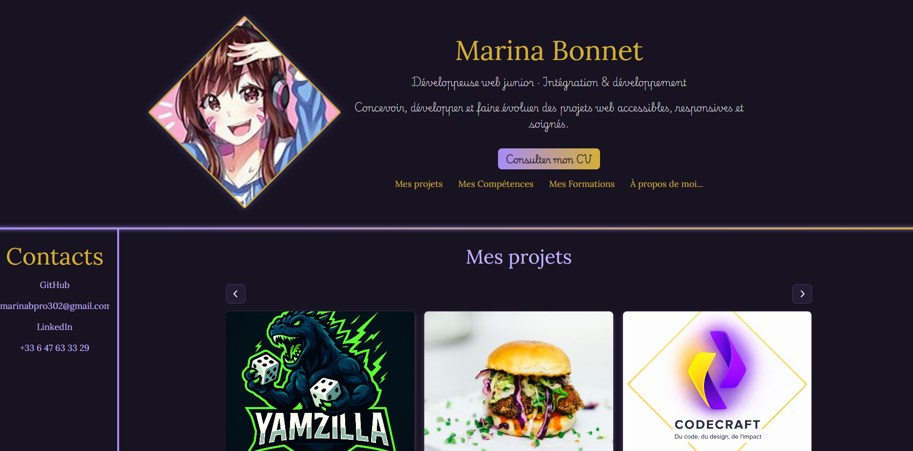

# Portfolio — Marina Bonnet

Développeuse web junior · Intégration web & développement

Bienvenue sur le dépôt de mon portfolio professionnel. Ce site présente mon parcours, mes compétences techniques et les projets réalisés au cours de ma formation et de mes projets personnels.

🔗 **Portfolio en ligne :** [marinabonnet.github.io/Portfolio](https://marinabonnet.github.io/Portfolio/)

  

## À propos

Après près de 20 ans dans le domaine de la cuisine, j’ai entrepris une reconversion professionnelle dans le développement web.

Titulaire du Titre professionnel Développeur Web et Web Mobile (DWWM), obtenu en novembre 2026, j'ai acquis des compétences en développement front-end et back-end, en conception d'applications web et en gestion de bases de données.

Je poursuis actuellement un Bachelor Développeur d'application C# / .NET afin d'approfondir mes connaissances en programmation et en développement logiciel.

Mon parcours m'a également permis de conserver et de développer des qualités essentielles : rigueur, organisation, autonomie, adaptabilité et travail en équipe.

Mon objectif est aujourd'hui de rejoindre une équipe en tant que développeuse web junior, pour contribuer à des projets concrets et continuer à progresser techniquement.

## Projets présentés

Le portfolio regroupe plusieurs projets illustrant différentes facettes du développement web.

| Projet | Description |
|---|---|
| **Yamzilla** | Projet web mettant en pratique JavaScript et l'intégration d'interactions côté client. |
| **Site de restaurant** | Projet d'intégration web axé sur la présentation d'un établissement et son identité visuelle. |
| **Code&Craft** | Projet personnel autour de mon activité freelance et de la création de solutions web. |
| **Esportify** | Plateforme de gestion de compétitions e-sport développée avec Symfony et PHP. |

## Compétences techniques

### Frontend
- HTML5
- CSS3
- Sass / SCSS
- JavaScript
- Intégration responsive
- Structuration et organisation des styles

### Backend
- PHP
- Symfony
- Architecture MVC
- Programmation orientée objet
- Gestion des formulaires et validation des données

### Bases de données
- SQL
- MySQL / MariaDB
- Modélisation des données

### Outils et méthodes
- Git et GitHub
- Visual Studio Code
- Docker et Docker Compose
- Vite
- Méthodes de développement et débogage

## Technologies du portfolio

Le portfolio utilise notamment :
- HTML pour la structure des pages ;
- Sass / SCSS pour organiser les styles ;
- JavaScript pour les interactions ;
- Git et GitHub pour le versionnement et l'hébergement.

Le site a été conçu pour s'adapter aux différentes tailles d'écran. Une attention particulière est portée à la lisibilité, à l'accessibilité et à la navigation.

## Consulter le portfolio

👉 [Découvrir mon portfolio en ligne](https://marinabonnet.github.io/Portfolio/)

## Contact

- **GitHub :** [MarinaBonnet](https://github.com/MarinaBonnet)
- **Portfolio :** [marinabonnet.github.io/Portfolio](https://marinabonnet.github.io/Portfolio/)
- **CV :** [Consulter mon CV](https://marinabonnet.github.io/cv-marina-bonnet/)

Je suis ouverte aux opportunités professionnelles en développement web junior.

---

*Portfolio réalisé dans le cadre de mon parcours de reconversion et de ma progression en développement web.*
